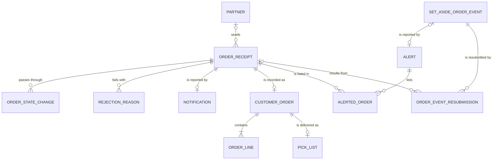

# Entity Model

## Entity Relationship Diagram

### PARTNER

A shop registered from the released Partner Configuration that sends Partner Orders over HTTP, identified by its API Key.

| Attribute           | Description                                                                          | Data Type | Length/Precision | Validation Rules        |
|---------------------|--------------------------------------------------------------------------------------|-----------|------------------|-------------------------|
| id                  | Unique identifier                                                                    | Long      | 19               | Primary Key, Sequence   |
| partner_code        | Partner identifier the Partner sends in every order (`partnerId`)                    | String    | 50               | Not Null, Unique        |
| name                | Name of the Partner's shop                                                           | String    | 100              | Not Null                |
| api_key_name        | Name under which the Partner's API Key is kept in the Secret Store; the key itself is never stored | String    | 100              | Not Null, Unique        |
| order_number_from   | First number of the Partner's Order Number Range (digits after `TG-`)                | Integer   | 10               | Not Null                |
| order_number_to     | Last number of the Partner's Order Number Range (digits after `TG-`)                 | Integer   | 10               | Not Null                |
| order_contact_email | Order Contact who receives the Partner's Rejection Emails                             | String    | 254              | Not Null, Format: Email |
| registered_at       | Date and time the Partner was registered from a released Partner Configuration       | DateTime  | -                | Not Null                |
| deregistered_at     | Date and time the Partner was removed from the Partner Configuration                 | DateTime  | -                | Optional                |

#### Constraints

- The last number of the Order Number Range must not be smaller than its first number (order_number_from ≤ order_number_to).
- The Order Number Ranges of two Partners never overlap.
- A Partner is registered only from a released Partner Configuration that passes every check; a Partner Configuration that fails a check changes no Partner.
- A Partner is registered only when the Secret Store holds an API Key under its api_key_name.
- A Partner removed from the Partner Configuration is deregistered (deregistered_at is set), never deleted, because receipts reference it; a deregistered Partner has no valid API Key.

### ORDER_RECEIPT

One Order as it arrived on a Channel, with its current Order State; kept for every Order, accepted or rejected, and without personal data except the Order a waiting Peakmart Order carries.

| Attribute       | Description                                                                                   | Data Type | Length/Precision | Validation Rules                                                  |
|-----------------|-----------------------------------------------------------------------------------------------|-----------|------------------|-------------------------------------------------------------------|
| id              | Unique identifier                                                                             | Long      | 19               | Primary Key, Sequence                                             |
| order_number    | Order Number as received (`TG-…` for a Partner Order, `PM-…` for a Peakmart Order)            | String    | 30               | Not Null                                                          |
| channel         | Channel the Order arrived on                                                                  | String    | 20               | Not Null, Values: Partner, Peakmart                               |
| partner_id      | Partner that sent the Partner Order                                                           | Long      | 19               | Optional, Foreign Key (PARTNER.id)                                |
| event_id        | Event id of the Peakmart Order Event the Order was first taken from, also when resubmitted    | String    | 100              | Optional                                                          |
| content_hash    | Hash of the order content, to tell a Partner resend from a reused Order Number                | String    | 64               | Not Null                                                          |
| correlation_id  | Correlation id carried by every log entry about the Order                                     | String    | 36               | Not Null, Unique                                                  |
| received_at     | Date and time the Order arrived                                                               | DateTime  | -                | Not Null                                                          |
| order_state     | Current Order State                                                                           | String    | 20               | Not Null, Values: Received, Rejected, Recorded, Sent to Warehouse |
| checking_since  | Date and time a request of the Partner Order began to be checked, while it has no answer yet  | DateTime  | -                | Optional                                                          |
| waiting_for     | What a waiting Peakmart Order waits for: to be checked (Catalog Outage) or to be recorded (Order Database unavailable) | String    | 20               | Optional, Values: Check, Recording                                |
| waiting_order   | The Peakmart Order as read from its Order Event, kept while it waits; holds personal data     | String    | 65535            | Optional                                                          |
| waiting_reason  | Why the Peakmart Order still waits (a fixed text or an exception kind, no personal data)      | String    | 500              | Optional                                                          |
| last_check_at   | Date and time the waiting Peakmart Order was last checked                                     | DateTime  | -                | Optional                                                          |

#### Constraints

- A Partner Order has a partner_id and no event_id; a Peakmart Order has an event_id and no partner_id.
- A Partner Order is received at most once with the same content (partner_id, order_number, content_hash are unique together for Partner receipts, that is the order number together with the Partner of the API Key); a resend is answered from the existing receipt, and a resend after a temporarily unavailable answer is checked on it.
- A Peakmart Order Number is received at most once, whatever its event id (order_number is unique among receipts of channel Peakmart).
- At most one receipt per Order Number is in the Order State Recorded or Sent to Warehouse.
- checking_since is set only on a Partner Order in the Order State Received, and is cleared when the request is answered.
- waiting_for and waiting_order are set only on a Peakmart Order in the Order State Received, both together, and are cleared when the Order is rejected or recorded.
- The receipt and everything linked to it is deleted 90 days after received_at.

### ORDER_STATE_CHANGE

One entry of an Order's Order History: an Order State the Order reached and when.

| Attribute        | Description                               | Data Type | Length/Precision | Validation Rules                                                  |
|------------------|-------------------------------------------|-----------|------------------|-------------------------------------------------------------------|
| id               | Unique identifier                         | Long      | 19               | Primary Key, Sequence                                             |
| order_receipt_id | Order the entry belongs to                | Long      | 19               | Not Null, Foreign Key (ORDER_RECEIPT.id)                          |
| order_state      | Order State the Order reached             | String    | 20               | Not Null, Values: Received, Rejected, Recorded, Sent to Warehouse |
| changed_at       | Date and time the Order reached the state | DateTime  | -                | Not Null                                                          |

#### Constraints

- An Order reaches each Order State at most once (order_receipt_id, order_state are unique together).

### REJECTION_REASON

One failed Order Check of a Rejected Order, as a text a person can act on.

| Attribute        | Description                                                                  | Data Type | Length/Precision | Validation Rules                                                                                                                                                 |
|------------------|------------------------------------------------------------------------------|-----------|------------------|------------------------------------------------------------------------------------------------------------------------------------------------------------------|
| id               | Unique identifier                                                            | Long      | 19               | Primary Key, Sequence                                                                                                                                            |
| order_receipt_id | Rejected Order the reason belongs to                                         | Long      | 19               | Not Null, Foreign Key (ORDER_RECEIPT.id)                                                                                                                         |
| order_check      | Order Check that failed                                                      | String    | 40               | Not Null, Values: Order Number Format, Order Number Range, Order Number Already Used, SKU, Quantity, Number of Order Lines, Shipping Address, Destination Country |
| line_number      | Order Line the reason refers to, when it refers to one                       | Integer   | 10               | Optional, Min: 1, Max: 30                                                                                                                                        |
| reason_text      | Rejection Reason naming the failed check and what to change                  | String    | 500              | Not Null                                                                                                                                                         |
| position         | Order of the reason in the answer, the Rejection Email and the Order History | Integer   | 10               | Not Null, Min: 1, Max: 100                                                                                                                                       |

#### Constraints

- Only an Order in the Order State Rejected has Rejection Reasons.
- The reasons of one Order are numbered without gaps (order_receipt_id, position are unique together).

### NOTIFICATION

The Rejection Email to a Partner's Order Contact or the Order Desk Notification for one Rejected Order, held until it is sent.

| Attribute         | Description                                                  | Data Type | Length/Precision | Validation Rules                                           |
|-------------------|--------------------------------------------------------------|-----------|------------------|------------------------------------------------------------|
| id                | Unique identifier                                            | Long      | 19               | Primary Key, Sequence                                      |
| order_receipt_id  | Rejected Order the notification reports                      | Long      | 19               | Not Null, Unique, Foreign Key (ORDER_RECEIPT.id)           |
| notification_type | Kind of notification                                         | String    | 30               | Not Null, Values: Rejection Email, Order Desk Notification |
| recipient_email   | Order Contact or Order Desk mailbox the notification goes to | String    | 254              | Not Null, Format: Email                                    |
| created_at        | Date and time the notification was created                   | DateTime  | -                | Not Null                                                   |
| sent_at           | Date and time the notification was sent                      | DateTime  | -                | Optional                                                   |
| attempts          | Number of attempts to send the notification                  | Integer   | 10               | Not Null, Min: 0, Max: 1000                                |
| last_attempt_at   | Date and time of the last attempt to send the notification   | DateTime  | -                | Optional                                                   |
| last_failure      | Why the last attempt failed (an exception kind, no personal data) | String    | 500              | Optional                                                   |

#### Constraints

- A Rejection Email belongs to a Partner Order and an Order Desk Notification to a Peakmart Order.

### CUSTOMER_ORDER

An Accepted Order as recorded once in the Order Database, with its Customer and Shipping Address.

| Attribute        | Description                                                         | Data Type | Length/Precision | Validation Rules                                 |
|------------------|---------------------------------------------------------------------|-----------|------------------|--------------------------------------------------|
| id               | Unique identifier                                                   | Long      | 19               | Primary Key, Sequence                            |
| order_receipt_id | Receipt of the Order that was accepted                              | Long      | 19               | Not Null, Unique, Foreign Key (ORDER_RECEIPT.id) |
| order_number     | Order Number of the Accepted Order                                  | String    | 30               | Not Null, Unique                                 |
| ordered_at       | Date and time the Customer placed the Order, as the Channel sent it | DateTime  | -                | Not Null                                         |
| customer_email   | Email address of the Customer                                       | String    | 254              | Optional, Format: Email                          |
| recipient_name   | Name of the Recipient                                               | String    | 100              | Not Null                                         |
| street_line      | Street line of the Shipping Address, address lines joined by ", "   | String    | 200              | Not Null                                         |
| city             | City of the Shipping Address                                        | String    | 100              | Not Null                                         |
| state_region     | State or province of the Shipping Address, when the Channel sends one | String    | 50               | Optional                                         |
| postal_code      | Postal code of the Shipping Address                                 | String    | 20               | Not Null                                         |
| country          | Country of the Shipping Address, ISO 3166-1 alpha-2                 | String    | 2                | Not Null, Values: US, CA                         |
| recorded_at      | Date and time the Order was recorded                                | DateTime  | -                | Not Null                                         |

#### Constraints

- order_number is the order_number of the linked ORDER_RECEIPT.

### ORDER_LINE

One Product of an Accepted Order with its quantity, price and the Product data from the Product Catalog.

| Attribute         | Description                                                                                              | Data Type | Length/Precision | Validation Rules                          |
|-------------------|----------------------------------------------------------------------------------------------------------|-----------|------------------|-------------------------------------------|
| id                | Unique identifier                                                                                        | Long      | 19               | Primary Key, Sequence                     |
| customer_order_id | Accepted Order the line belongs to                                                                       | Long      | 19               | Not Null, Foreign Key (CUSTOMER_ORDER.id) |
| line_number       | Number of the line within the Order                                                                      | Integer   | 10               | Not Null, Min: 1, Max: 30                 |
| sku               | SKU of the Product                                                                                       | String    | 50               | Not Null                                  |
| product_name      | Product name from the Product Catalog                                                                    | String    | 200              | Not Null                                  |
| quantity          | Number of items ordered                                                                                  | Integer   | 10               | Not Null, Min: 1, Max: 20                 |
| unit_price        | Price of one item in US dollars: Catalog Price for a Partner Order, Peakmart Price for a Peakmart Order | Decimal   | 10,2             | Not Null, Min: 0, Max: 99999999.99        |
| unit_weight_grams | Weight of one item in grams from the Product Catalog                                                     | Integer   | 10               | Not Null, Min: 0, Max: 1000000            |

#### Constraints

- Each line number occurs once per Order (customer_order_id, line_number are unique together).
- The Total Weight of an Order is the sum of quantity × unit_weight_grams over its lines.

### PICK_LIST

The Pick List of one Accepted Order, held until it is delivered to the Warehouse SFTP Server exactly once.

| Attribute         | Description                                                                 | Data Type | Length/Precision | Validation Rules                                  |
|-------------------|-----------------------------------------------------------------------------|-----------|------------------|---------------------------------------------------|
| id                | Unique identifier                                                           | Long      | 19               | Primary Key, Sequence                             |
| customer_order_id | Accepted Order the Pick List is for                                         | Long      | 19               | Not Null, Unique, Foreign Key (CUSTOMER_ORDER.id) |
| file_name         | File name on the Warehouse SFTP Server, `PL-<Order Number>.csv`             | String    | 50               | Not Null, Unique                                  |
| total_weight_g    | Total Weight of the Order in grams                                          | Integer   | 10               | Not Null, Min: 0, Max: 2000000000                 |
| delivery_state    | Whether the file is delivered                                               | String    | 20               | Not Null, Values: Pending, Delivered              |
| created_at        | Date and time the Pick List was created                                     | DateTime  | -                | Not Null                                          |
| last_attempt_at   | Date and time of the last delivery attempt                                  | DateTime  | -                | Optional                                          |
| attempts          | Number of delivery attempts                                                 | Integer   | 10               | Not Null, Min: 0, Max: 100000                     |
| delivered_at      | Date and time the file was renamed from `.tmp` on the Warehouse SFTP Server | DateTime  | -                | Optional                                          |
| last_failure      | Why the last delivery attempt failed (an exception kind, no personal data)  | String    | 500              | Optional                                          |

#### Constraints

- delivered_at is set exactly when delivery_state is Delivered.

### ALERT

One Alert email to the Integration Team mailbox, held until it is sent, about Orders past a time limit, a Set-Aside Order Event, or the Peakmart order topic not being read.

| Attribute                | Description                                                         | Data Type | Length/Precision | Validation Rules                                                                                    |
|--------------------------|---------------------------------------------------------------------|-----------|------------------|-----------------------------------------------------------------------------------------------------|
| id                       | Unique identifier                                                   | Long      | 19               | Primary Key, Sequence                                                                               |
| alert_kind               | What the Alert is about                                             | String    | 30               | Not Null, Values: Not Sent to Warehouse, Peakmart Order Waiting, Order Event Set Aside, Peakmart Topic Not Read |
| set_aside_order_event_id | Set-Aside Order Event the Alert reports                             | Long      | 19               | Optional, Unique, Foreign Key (SET_ASIDE_ORDER_EVENT.id)                                            |
| topic_last_read_at       | Date and time the Peakmart order topic was last read                | DateTime  | -                | Optional                                                                                            |
| raised_at                | Date and time the Alert was raised                                  | DateTime  | -                | Not Null                                                                                            |
| sent_at                  | Date and time the Alert was sent                                    | DateTime  | -                | Optional                                                                                            |
| last_attempt_at          | Date and time of the last attempt to send the Alert                 | DateTime  | -                | Optional                                                                                            |
| attempts                 | Number of attempts to send the Alert                                | Integer   | 10               | Not Null, Min: 0, Max: 100000                                                                       |

#### Constraints

- An Alert of kind Not Sent to Warehouse or Peakmart Order Waiting lists at least one Order and has no set_aside_order_event_id and no topic_last_read_at.
- An Alert of kind Order Event Set Aside has a set_aside_order_event_id, lists no Order and has no topic_last_read_at.
- An Alert of kind Peakmart Topic Not Read has a topic_last_read_at, lists no Order and has no set_aside_order_event_id.
- The Integration Team is alerted at most once per time the topic was last read (alert_kind, topic_last_read_at are unique together), so no further Alert is raised until the topic has been read again.
- An Alert is deleted 90 days after raised_at.

### ALERTED_ORDER

One Order listed in an Alert, which notes in its Order History that the Integration Team was alerted about it for one time limit.

| Attribute        | Description                                                                          | Data Type | Length/Precision | Validation Rules                         |
|------------------|--------------------------------------------------------------------------------------|-----------|------------------|------------------------------------------|
| id               | Unique identifier                                                                    | Long      | 19               | Primary Key, Sequence                    |
| alert_id         | Alert that lists the Order                                                           | Long      | 19               | Not Null, Foreign Key (ALERT.id)         |
| order_receipt_id | Order the Alert lists                                                                | Long      | 19               | Not Null, Foreign Key (ORDER_RECEIPT.id) |
| waiting_for      | For a waiting Peakmart Order: whether it waits to be checked or to be recorded       | String    | 20               | Optional, Values: Check, Recording       |
| waiting_since    | Date and time the Order was recorded (not sent to warehouse) or arrived (Peakmart Order waiting) | DateTime  | -                | Not Null                                 |
| waiting_minutes  | How long the Order had been waiting when the Alert was raised, in minutes            | Integer   | 10               | Not Null, Min: 0, Max: 129600            |

#### Constraints

- An Order is alerted at most once for each time limit: no two ALERTED_ORDER rows of one order_receipt_id belong to Alerts of the same alert_kind.
- waiting_for is set exactly when the Alert is of kind Peakmart Order Waiting, and only a Peakmart Order is listed in such an Alert.
- The Order counts as alerted in its Order History only once the Alert is sent (ALERT.sent_at is set).

### SET_ASIDE_ORDER_EVENT

A Peakmart Order Event of type `order.placed` that cannot be read as an Order, kept with its event id for the Integration Team to examine and resubmit.

| Attribute          | Description                                                                               | Data Type | Length/Precision | Validation Rules               |
|--------------------|-------------------------------------------------------------------------------------------|-----------|------------------|--------------------------------|
| id                 | Unique identifier                                                                         | Long      | 19               | Primary Key, Sequence          |
| event_id           | Event id of the Order Event                                                               | String    | 100              | Not Null, Unique               |
| order_number       | Order Number of the Order Event, when it can be read                                      | String    | 30               | Optional                       |
| event_content      | The Order Event as it arrived, or as last corrected by a resubmission; holds personal data | String    | 65535            | Not Null                       |
| cannot_read_reason | What cannot be read, readable by a person and without personal data                       | String    | 500              | Not Null                       |
| arrived_at         | Date and time the Order Event arrived                                                     | DateTime  | -                | Not Null                       |
| set_aside_state    | Whether the Order Event is still set aside or was taken out by a resubmission             | String    | 20               | Not Null, Values: Set Aside, Resubmitted |

#### Constraints

- An Order Event is set aside at most once; a redelivery of an event id already set aside is not set aside again.
- Only a Set-Aside Order Event in the state Set Aside can be resubmitted.
- The Set-Aside Order Event and its resubmissions are deleted 90 days after arrived_at.

### ORDER_EVENT_RESUBMISSION

One resubmission of a Set-Aside Order Event by an Integration Team member, with who resubmitted it, when, and how it ended.

| Attribute                | Description                                                                          | Data Type | Length/Precision | Validation Rules                                        |
|--------------------------|--------------------------------------------------------------------------------------|-----------|------------------|---------------------------------------------------------|
| id                       | Unique identifier                                                                    | Long      | 19               | Primary Key, Sequence                                   |
| set_aside_order_event_id | Set-Aside Order Event that was resubmitted                                           | Long      | 19               | Not Null, Foreign Key (SET_ASIDE_ORDER_EVENT.id)        |
| resubmitted_by           | Integration Team member who resubmitted the Order Event                              | String    | 100              | Not Null                                                |
| resubmitted_at           | Date and time of the resubmission                                                    | DateTime  | -                | Not Null                                                |
| content_corrected        | Whether the Order Event was resubmitted with corrected content                       | Boolean   | 1                | Not Null                                                |
| result                   | How the resubmission ended                                                           | String    | 20               | Not Null, Values: Taken In, Already Received, Still Unreadable |
| order_receipt_id         | Receipt of the Peakmart Order taken in, or of the Order already received             | Long      | 19               | Optional, Foreign Key (ORDER_RECEIPT.id)                |
| unreadable_reason        | What still cannot be read, without personal data                                     | String    | 500              | Optional                                                |

#### Constraints

- order_receipt_id is set exactly when result is Taken In or Already Received, and unreadable_reason exactly when result is Still Unreadable.
- A resubmission with result Taken In or Already Received sets its SET_ASIDE_ORDER_EVENT to Resubmitted; one with result Still Unreadable leaves it Set Aside.
- A Set-Aside Order Event has at most one resubmission with result Taken In or Already Received.

## Change notes

### 2026-11-13, pipeline 003-partner-orders-pick-lists, design review R1

- PARTNER: added `deregistered_at`; a Partner removed from the Partner Configuration is deregistered, never deleted, because receipts reference it, and a deregistered Partner has no valid API Key.
- ORDER_RECEIPT: the uniqueness rule for Partner receipts is now (partner_id, order_number, content_hash) together, replacing (order_number, content_hash).

### 2026-11-14, pipeline 005-hardening (design §3.6, §3.7, §7)

Raised by: design 005. Flyway V3 (`V3__failure_reasons.sql`). Each new attribute is nullable (Optional), holds no personal data (a fixed text or an exception kind, never request or order content; NFR-011, C-021, C-023), and is deleted with its row 90 days after the receipt arrived (C-022).

- ORDER_RECEIPT: added `waiting_reason` and `last_check_at`; a waiting Peakmart Order is checked again the one checked longest ago first. waiting_reason is set only while waiting_for is set (V3 check); waiting_reason and last_check_at are cleared when the Order is rejected or recorded.
- PICK_LIST: added `last_failure`.
- NOTIFICATION: added `last_failure` and `last_attempt_at`.
